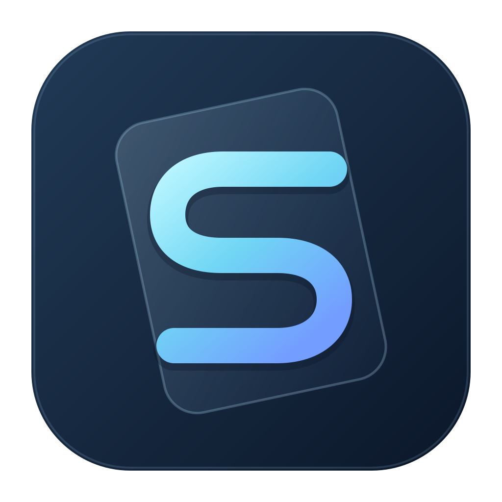
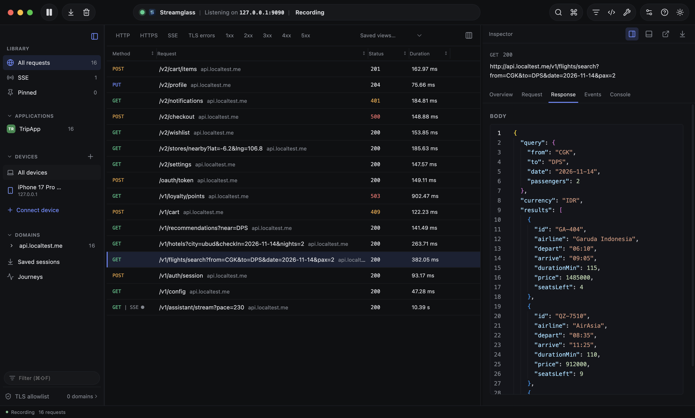
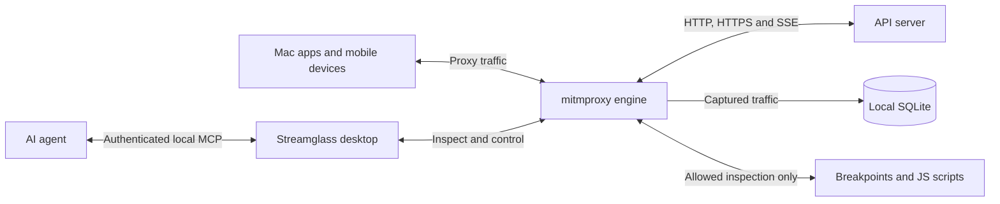

<p align="center"></p>

# Streamglass

A macOS traffic workbench for HTTP, HTTPS, and server-sent events. See what an app sends, pause a response, edit an event, and let the connection continue.

<p align="center"></p>

<p align="center"><sub>Screenshot uses synthetic example data.</sub></p>

Streamglass combines an Electron desktop app, a React inspector, and a bundled mitmproxy engine. Rules and settings are stored on your Mac; captured traffic is kept only while the app runs and is deleted when you quit. The packaged app includes its engine; using it does not require Python, Node.js, or Xcode.

## How it works



Clients send traffic through the local proxy. HTTPS content is visible only when the client trusts the certificate and the domain has SSL inspection enabled; otherwise, Streamglass shows encrypted connection metadata. SSE events arrive progressively. Breakpoints and scripts can change inspected traffic; **Pause capture and rules** bypasses both and forwards traffic without new capture. See [architecture](docs/ARCHITECTURE.md) for the detailed lifecycle and limits.

## What it does

- Inspect requests, responses, encrypted HTTPS destinations, and individual SSE events.
- Find traffic by URL, request, response, or event content; filter by device or local application, with app icons where available.
- Pause requests, responses, and SSE events with wildcard breakpoint rules, then edit or drop them in dedicated windows.
- Transform matching traffic with sandboxed JavaScript hooks and inspect their console output.
- Read formatted JSON with folding and precise numeric text; expand headers when needed.
- Export a selected capture as cURL or JSON, or export all retained captures as a session file.
- Follow the active Mac network automatically, prepare simulator capture, and connect Android or iOS devices.
- Connect a local AI client through the authenticated [MCP server](docs/MCP.md), including gradual SSE event delivery.
- Pin captures, combine HTTP/HTTPS/SSE and status-family filters, choose table columns, and place the inspector below or to the right.
- Serve local response fixtures with Map Local and simulate request latency and per-flow upload/download rates. Active-tool pills open their settings.
- Diagnose SSE timing, run repeatable scenarios, compare captures, create mocks, edit and resend requests, share redacted exports, and switch configuration workspaces.
- Configure optional decoded views and response re-encoding at breakpoints; app-specific encryption protocols require a matching codec.
- Save and reopen capture archives, correlate search journeys with a waterfall, watch JSONPath values, evaluate assertions, repeat requests with limits, and save filters with capture notes/highlights.

## Install or update

On an Apple silicon Mac, run:

```sh
curl -fsSL https://raw.githubusercontent.com/salomohutapea/streamglass/main/scripts/install.sh | bash
```

The script asks where to install Streamglass:
- `/Applications`, which may need an administrator password;
- `~/Applications`, which needs no admin rights and suits managed office Macs;
- the current folder;
- or a folder you type.

It defaults to the folder where Streamglass is already installed. It downloads the latest release and checks it against the release's `SHA256SUMS.txt`. It then quits a running Streamglass, replaces the app in that folder and opens the new copy.

To update, run the same command and pick the same folder. If that version is already installed, it just opens the app. Releases are unsigned, so the script removes the macOS quarantine flag, which lets the app open without a Gatekeeper prompt. Only run it if you trust this repository's releases.

Optional environment variables:
- `STREAMGLASS_DIR=~/Applications` installs to that folder without asking.
- `STREAMGLASS_VERSION=1.0.4` installs a specific version.
- `STREAMGLASS_FORCE=1` reinstalls the version you already have.

## Start capturing

Open Streamglass and choose **Connect device**. For Mac traffic, enable Mac capture; for HTTPS content, trust the local certificate and add the destination domains to the TLS allowlist. For a booted iOS simulator, **Prepare simulator capture** combines the setup steps. See [device setup](docs/DEVICES.md) for Android, physical iOS, certificate trust, managed Macs, and proxy restoration.

For a first local inspection, start the proxy, configure a client to use the address shown in **Connect device**, and send a request to a test endpoint you control. Select its row to inspect the request and response. If the row is an encrypted HTTPS destination, complete certificate trust and allowlist setup, then reconnect and retry the request. To inspect an SSE stream, open its **SSE** tab; events appear as they arrive. When finished, turn off Mac capture if enabled and use the app's restoration controls before removing a development profile.

Only allowlisted HTTPS domains are decrypted. Other HTTPS connections appear as encrypted destinations. Adding a domain can interrupt its existing encrypted connections so the client reconnects with inspection enabled.

**Pause capture and rules** forwards traffic without new capture, breakpoints, or scripts. Waiting breakpoints continue with their original value. Existing pass-through requests and streams stay pass-through until they finish. **Stop Proxy** interrupts active traffic. Deleting a capture removes retained data and does not stop its connection.

## Run from source

Requires macOS, Node.js 22.12 or newer, and Python 3.12 or newer.

```sh
npm run dev
```

The development launcher installs missing dependencies, prepares the Python environment, starts the UI and engine, and opens Electron. Development uses an isolated data directory and ports so it can run alongside the packaged app. See the [development guide](docs/DEVELOPMENT.md) for details and troubleshooting.

## Build a local release

```sh
npm run build:release
```

This builds the UI, freezes the engine, and packages a macOS app and installers. Local releases are unsigned and unnotarized. Signing and notarization require Apple credentials and an explicit signed release; see [release instructions](docs/DEVELOPMENT.md#local-releases).

## Guides

Start with [workflows](docs/WORKFLOWS.md) for capture and breakpoints, [testing tools](docs/TESTING_TOOLS.md) for controlled traffic experiments, or [daily debugging](docs/DAILY_TOOLS.md) for saved captures and analysis. Contributors can follow the [agent guide](docs/AGENT_GUIDE.md) to the owning source and tests. The [development guide](docs/DEVELOPMENT.md) contains a verification matrix and local release checklist.

| Guide | Covers |
| --- | --- |
| [Workflows](docs/WORKFLOWS.md) | Search, breakpoints, JavaScript hooks, JSON editing, exports, and capture limits |
| [Testing tools](docs/TESTING_TOOLS.md) | SSE timeline, scenarios, comparison, replay, mocks, redaction, workspaces, and codecs |
| [Daily debugging](docs/DAILY_TOOLS.md) | Saved sessions, journey waterfall, JSONPath watches, assertions, repeated replay, saved views, and notes |
| [Device setup](docs/DEVICES.md) | Mac networks, simulators, Android, physical iOS, trust, and restoration |
| [MCP](docs/MCP.md) | Client configuration, tools, authentication, and streaming notifications |
| [Architecture](docs/ARCHITECTURE.md) | Runtime components, data flow, storage, and isolation |
| [Development](docs/DEVELOPMENT.md) | Setup, commands, verification matrix, and troubleshooting |
| [Release qualification](docs/RELEASE.md) | Candidate checklist and evidence record |
| [Pre-1.0.0 hardening](docs/HARDENING.md) | Executed checks, improvements, and remaining release blockers |
| [Agent guide](docs/AGENT_GUIDE.md) | Where to start, source ownership, and feature-to-test map |
| [Feature contracts](docs/FEATURE_CONTRACTS.md) | Cross-layer changes, traffic invariants, persistence, and MCP parity |
| [Feature roadmap](docs/ROADMAP.md) | Implemented workbench additions and follow-up ideas |
| [Contributing](CONTRIBUTING.md) | Focused changes and useful verification |
| [Security](SECURITY.md) | Captured secrets, local access, certificate handling, and reporting |
| [Security review](docs/SECURITY_REVIEW.md) | Hardening evidence, dependency repairs and qualification limits |
| [Dependency compatibility build](docs/DEPENDENCY_PATCH.md) | Reproducible mitmproxy patch, provenance and maintenance |
| [Architecture review](docs/ARCHITECTURE_REVIEW.md) | SOLID assessment, extension seams, and remaining design limits |

## Current limits

The current dependency build targets macOS Apple Silicon; Intel is not qualified because the updated cryptography package no longer provides Intel macOS wheels. Local application attribution is best-effort; remote devices are identified by peer address and may share an address. Apps that ignore system proxies or pin certificates may need app-specific debug configuration. OS and organization policies still apply.

Capture retention, viewers, scripting, and editable bodies are bounded. Streamed bodies may have previews rather than complete retained content; exports identify unavailable data. Streamglass does not recover events that were forwarded without retention. Physical-device workflows, Intel packaging, signed distribution, and long-duration load need qualification on the intended target.

## Contributing

Direct pull requests are not accepted from branches in this repository. Contribute from your own fork:

1. Fork [salomohutapea/streamglass](https://github.com/salomohutapea/streamglass) on GitHub.
2. Clone your fork and add this repository as `upstream`:
   ```sh
   git clone https://github.com/<you>/streamglass.git
   cd streamglass
   git remote add upstream https://github.com/salomohutapea/streamglass.git
   ```
3. Create a branch from the latest `main` (`git fetch upstream && git checkout -b my-change upstream/main`).
4. Run `npm run setup`, then make your change. Read [CONTRIBUTING.md](CONTRIBUTING.md) and the [development guide](docs/DEVELOPMENT.md) first. Use synthetic data only, never real captures or credentials.
5. Check your work with `npm run typecheck` and the tests that cover what you changed (see the test matrix in the development guide).
6. Push the branch to your fork and open a pull request against `main` here. Describe the problem, the resulting behavior, and which checks you ran.
7. The `Test` check must pass (a maintainer approves the first run for new contributors), and a code owner must approve the PR before it is merged.

## License

Streamglass is released under the [MIT License](LICENSE). Bundled third-party software keeps its own licenses.
