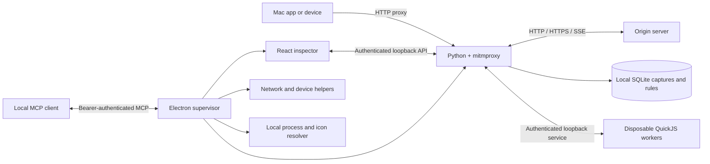

# Architecture

Streamglass is a macOS-first Electron application with a React/TypeScript renderer, a Python mitmproxy engine, and isolated QuickJS JavaScript workers. This document describes the current implementation; [workflows](WORKFLOWS.md) covers user-facing behavior.

## Components

| Location | Responsibility |
| --- | --- |
| `electron/main.mjs`, `preload.cjs`, `menu.mjs` | Process lifecycle, isolated windows, narrow IPC, native menus, exports |
| `electron/devices.mjs` | Network monitoring, proxy snapshots/restoration, fixed certificate and device actions |
| `electron/applications.mjs` | Best-effort local connection ownership and application icons |
| `electron/script-service.mjs`, `script-worker.mjs` | Validated script requests and bounded QuickJS execution |
| `electron/mcp-*.mjs` | MCP transports, credentials, tool schemas, and engine API adapter |
| `backend/__main__.py`, `api.py`, `service.py` | Engine lifecycle, authenticated management API, records, rules, gates, SQLite persistence |
| `backend/engine.py`, `sse.py`, `large_body.py` | Async stream extension, SSE framing, bounded large-body capture |
| `backend/traffic_tools.py`, `frontend/src/TrafficTools.tsx`, `electron/map-local-file.mjs` | Validated Map Local snapshots, per-flow network profiles, and bounded native file import |
| `backend/lab.py`, `frontend/src/LabPanel.tsx`, `SseTimeline.tsx` | Scenarios, capture-derived fixtures, explicit replay, and SSE diagnostics |
| `backend/capture_sessions.py`, `frontend/src/DailyTools.tsx`, `electron/export-session.mjs` | Immutable archived capture sets and bounded streaming session files |
| `backend/productivity.py`, `frontend/src/daily-tools.mjs` | Bounded JSONPath analysis, correlation, background assertions, and revisioned view/watch preferences |
| `backend/repeat_replay.py` | One owned sequential repeat job, per-request timeout, cancellation and result metadata |
| `backend/codecs.py`, `frontend/src/CodecPanel.tsx` | Optional bounded codecs, ephemeral keys, and decoded breakpoint validation |
| `electron/workspaces.mjs`, `backend/api.py` workspace routes | Named configuration snapshots and atomic engine replacement |
| `frontend/src/` | Traffic table, filters, inspector, rules, editors, device and MCP settings |

Electron starts a separate engine process and supplies a random per-launch management token. Development serves the renderer through Vite; packaged windows load local assets through the `app://streamglass` scheme. Renderer windows use sandboxing and context isolation with Node integration disabled. The preload bridge exposes selected desktop actions, not general filesystem or command execution.

The engine management listener uses a dynamically selected loopback port. It validates bearer credentials and management Host/Origin values. The proxy is a separate listener: all interfaces on port `9090` by default so physical devices can connect (LAN access can be turned off in Proxy settings; existing profiles keep their saved choice). Development overrides its defaults; see [development](DEVELOPMENT.md). Enabling LAN proxy access does not expose the management API.

The renderer polls `/api/state` every second and passes back the `etag` from its last snapshot. When nothing changed, the engine replies `{"unchanged": true}` instead of every row. Rows are serialized once per engine revision. Each application's icon is sent once in `applicationIcons`, not in every row. Each row carries a `rev`, so the inspector refetches a record only when its row changes. It asks `/api/records/{id}?compact=1&afterEvent=N` for only the new events, without the raw wire copies. Electron watches breakpoints through the small `/api/pending` endpoint. The API also provides WebSocket snapshots, which are built only while a client is connected. Editor windows are distinct from the read-only inspector; pending gates share one Breakpoints window (`editor=paused`, deep-linked by `#gate=<token>`). Tools uses a separate reusable `editor=tools` window with the same authenticated engine. Narrow validated IPC carries section/capture/filter context and routes capture selection or saved views back to its originating traffic window. It is non-modal and non-fullscreenable. Headers are collapsed disclosures, and JSON content supports folding and bounded pages.

## Request and breakpoint lifecycle

Rules match URL wildcards and optional HTTP methods, in list order. A rule can target request, response, or SSE-event stages, run JavaScript, create a breakpoint, or combine both. Scripts transform the message before a single breakpoint presents the combined result. Header pairs preserve duplicate names; bodies include text and base64 representations. Edits are validated before application.

Rule-list replacement uses optimistic concurrency: `/api/state` supplies `rulesRevision`, and `/api/rules` requires that revision with the replacement list. A stale writer receives `revision_conflict` and must reload. Folder changes and workspace loads that alter rules advance the revision. This protects one client's rule edits from being silently replaced by another client's stale list.

Request gates pause before upstream dispatch. Buffered response gates pause before downstream dispatch. SSE response headers can be edited before streaming begins; individual event gates can then edit event fields, but cannot change headers already sent. Gates have unique tokens, reject stale or duplicate resumes, and have no timeout: a gate waits until the user or MCP resolves it, capture is paused, the proxy stops, the client disconnects, or the app quits. mitmproxy disarms its 600-second `tcp_timeout` inactivity watchdog while a hook is running, so a paused request or response gate is not closed by it. Streamglass does not add its own wait limit; the client app's HTTP timeout, the upstream server's idle timeout, and any intermediary timeout can still end a long pause and cannot be extended from here (the gate then disappears from the list). Continue applies the accepted value; Drop terminates the flow.

Capture pause switches traffic to pass-through and bypasses rules. Waiting gates continue with their original values, and unsent script results are discarded. Already transmitted edits cannot be undone. Requests started while paused and streams switched to pass-through retain that mode until completion. Deleting retained data leaves live connections and pending gates intact; stopping the proxy terminates active traffic.

## Streaming and limits

Stock mitmproxy streaming callbacks cannot await an interactive editor. `backend/engine.py` checks the pinned mitmproxy version (`12.2.3`) and expected method source before applying an in-memory extension that yields asynchronous addon hooks. Installed mitmproxy files are not changed. A version or source mismatch fails startup rather than silently disabling interception.

The SSE parser handles split line endings, multiline data, UTF-8 boundaries, comments, IDs, retry fields, and incomplete EOF frames. Unedited event blocks preserve their original bytes. Supported compression is decoded incrementally. Edited streams remove obsolete length and encoding headers.

Each paused stream has a bounded queue; overflow terminates that stream. This is a memory bound rather than a guarantee of complete HTTP/2 backpressure. Editable SSE events are limited to 8 MiB. Oversized events without a matching event rule switch the remaining stream to exact forwarding with a capture warning; a rule requiring full-event processing instead receives an explicit limit error. Retention can stop while forwarding continues.

Large or unknown-length REST responses use bounded capture previews. Their full bodies cannot be edited or exported as though retained. Response status and headers remain editable before forwarding begins. See [large-response behavior](WORKFLOWS.md#large-responses) for practical limits.

## Scripts

JavaScript hooks receive serialized request, response, or event objects. QuickJS runs inside disposable workers with time, memory, stack, output, and concurrency bounds. Scripts have no Node, filesystem, network, or device APIs. Bounded console output is attached to the capture. Script or validation failures terminate the affected flow and are visible to the user. The hook contract and examples are in [workflows](WORKFLOWS.md#rules-and-scripts).

## Persistence and exports

Map Local and network profiles persist under the `trafficTools` config key; `/api/traffic-tools` reads/replaces the validated configuration. State snapshots omit base64 fixture bodies and include their decoded sizes. The desktop imports a chosen file snapshot through trusted IPC; the engine receives bytes, not a filesystem path. A matching local response is selected after request rules and enters the existing response pipeline. Pausing an unsent synthetic response returns to upstream dispatch using the original request. Active Map Local requires bounded request buffering; see [workflows](WORKFLOWS.md#map-local).

Network delay is asynchronous and cancellable on capture pause. Rate shaping uses small asynchronous send chunks for HTTP request/response bytes, including SSE. A fast path preserves normal forwarding when rates are not enabled or a flow does not match. Rates are per flow, selected for new requests; opaque tunnels are not shaped.

Pins are persisted inside capture records. Automatic eviction skips pinned entries but keeps the storage budget bounded; explicit delete/clear includes them. Captures for TLS-allowlisted domains (and any capture that was SSL-inspected) are never evicted and do not count toward the 1,000-capture and 256 MiB budget, which applies to all other traffic; unpinned, non-allowlisted captures are evicted oldest first. Live captures do not outlive a session: the engine deletes every capture on a graceful stop and again at startup (covering a crash), while rules, settings, TLS domains, and saved capture sessions remain. Workbench layout/column preferences are renderer-local and do not alter capture contents.

The engine stores retained records and configuration in `captures.sqlite3` under Electron's application-data directory. The database runs in WAL mode. SSE events live in their own append-only `events` table, one row per event, so a growing stream never rewrites its history. A retained event keeps `rawBase64` only when `raw` can't represent its bytes; exports and saved sessions always include it. Settings, rules, folders, device labels, network-monitor configuration, saved proxy snapshots, MCP credentials, and the local CA live under application data. `STREAMGLASS_DATA_DIR` selects an alternate profile. Captures are local files containing sensitive plaintext, not an encrypted vault.

Selected-capture exports return cURL, request/response JSON, or retained SSE events. Export all streams a session JSON containing retained records, including encrypted tunnel metadata and incomplete-capture warnings. The desktop writer uses a private temporary file and renames it after successful completion. Exports do not reconstruct missing bodies or events.

Named capture archives occupy separate `capture_sessions` and `session_records` SQLite tables. They never replace live captures. `.sgsession` transfers stream newline-delimited JSON; imports validate a bounded staged set before one transaction inserts the archive. Daily preferences persist under `productivity` and are included in configuration workspaces. Analysis caches are invalidated on capture changes; a cancellable background task computes assertion summaries without editing flows. JSONPath analysis is explicitly incomplete beyond its byte/event/expansion budgets.

Repeated replay reuses the validated request builder and pinned mitmproxy replay handler. Each job owns one flow at a time, awaits its completion with a deadline, and cancels only its transports and pending flow on cancellation. Jobs and their bounded result history live in memory; shutdown cancels them before stopping the proxy.

## Devices, applications, and TLS

Mac monitoring follows the active network and saves previous proxy values before changing them. An advanced override handles ambiguous network selection. Simulator preparation combines certificate setup and Mac proxy monitoring; certificate-only setup supports managed environments where network settings require IT configuration. Physical Android Wi-Fi setup needs no ADB; optional automatic Android helpers require `adb` and authorized debugging. Physical iOS trust remains an explicit device workflow. Before stopping the listener on quit, Streamglass suspends monitoring and restores Mac proxy fields still pointing at its listener without prompting for administrator credentials. Monitoring intent survives for the next launch. Failed restoration retains recovery snapshots and shows a warning, as do outstanding managed Android overrides; externally changed Mac proxy fields are preserved.

Local process resolution runs in the background and groups known application helpers under their app. It is best-effort: unsupported, short-lived, or ambiguous connections can remain unattributed. Remote clients are grouped by peer address. Device platform icons use captured user-agent hints, with generic fallbacks.

A private CA is generated locally. Only public certificate files are offered for device installation. TLS inspection is opt-in by domain; upstream certificate verification stays enabled. Enabling inspection closes existing opaque tunnels newly matched by the allowlist so clients can reconnect. Unrelated and already-inspected connections stay open. Tunnel metadata never enters the HTTP breakpoint/script pipeline, and existing tunnel records cannot be decrypted retroactively.

Certificate trust, app pinning, system permissions, and device-management restrictions remain platform constraints. See [device setup](DEVICES.md) and [security](../SECURITY.md).

## MCP boundary

Decoded response text is an ephemeral view, not retained capture content. Codec profiles are persisted, but AES keys remain in engine memory and are excluded from workspace/MCP output. Changed decoded responses must pass encode/decode round-trip verification before the existing resume validator accepts them; unchanged responses retain original bytes. Generic primitives do not implement a backend-selected app envelope automatically.

Scenario rules are persisted configuration; one-shot consumption is session state. Request replay uses mitmproxy's client replay after validating an explicit HTTP request. Captured SSE event frames support timed synthetic responses through the asynchronous send path, rather than delaying a fully buffered response. Timeline timestamps are measured at the proxy.

Configuration workspaces atomically replace domains, rules/folders, traffic tools, scenarios and codec profiles through the management API. Electron serializes local snapshot file writes and preserves the current configuration before switching. Listener settings, OS proxy state, CA material, capture history and session keys are outside workspace scope.

Electron exposes the running engine through the official MCP SDK using Streamable HTTP and legacy HTTP+SSE transports. The default endpoint is `http://127.0.0.1:48722/mcp`. MCP uses a dedicated persisted bearer token, loopback binding, Host validation, and rejection of browser Origin headers.

Tools read retained captures and SSE events, manage rules/folders, resolve pending gates, update capture/proxy/TLS settings, and export text through the existing engine validators. They do not install certificates, change OS proxy settings, run shell commands, or expose arbitrary filesystem access. Reads, edits, and notifications have explicit output and transport bounds. See [MCP](MCP.md) for the tool contract and client setup.

## Qualification

The repository contains backend, JavaScript, and desktop integration suites. Verification results depend on the exact checkout, engine package, architecture, and device. A successful local build does not establish physical-device compatibility, long-duration reliability, Intel packaging, or signed/notarized distribution. The [development guide](DEVELOPMENT.md) lists checks that can be run when requested.
